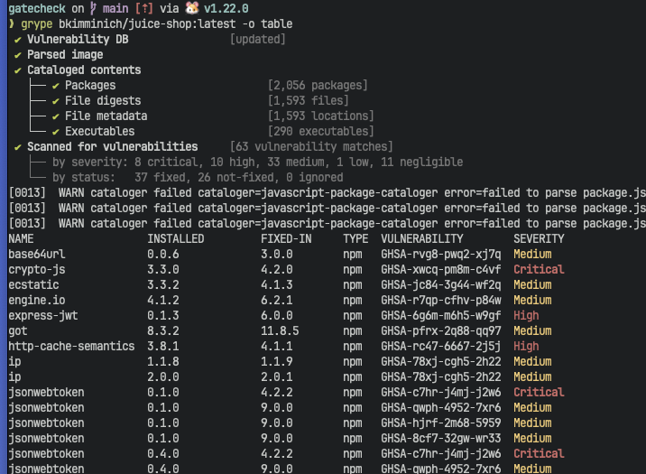
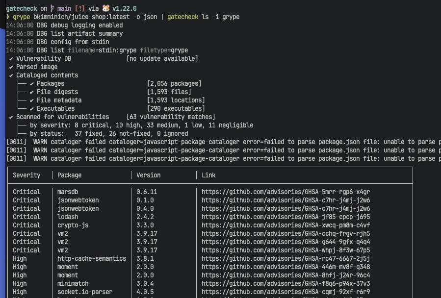

# List Reports

Most scanning tools can print their own table. Grype is one example:

```shell
grype bkimminich/juice-shop:latest -o table
```



Gatecheck prints a shorter table from the JSON those tools already emit. Pipe the JSON in, or point the command at a file.

```shell
grype bkimminich/juice-shop:latest -o json | gatecheck ls --input-type grype
```

```shell
gatecheck ls grype-scan-report.json
```



The report type comes from the file contents. The filename, or `--input-type` on standard input, is used when the contents are ambiguous. `grype-scan-report.json` still works. See [Supported Reports](./supported-reports.md).

`--markdown` prints a markdown table instead of the plain text table.

`--epss` adds the EPSS score and percentile for Grype, CycloneDX, Trivy, and osv-scanner. Other reports ignore that data. With no `--epss-filename`, gatecheck downloads the CSV from FIRST. `GATECHECK_EPSS_FILENAME` and `GATECHECK_EPSS_URL` are the same settings as those flags.

```shell
gatecheck download epss > epss.csv
gatecheck list --epss --epss-filename epss.csv grype-scan-report.json
```

Columns:

- Grype: severity, package, version, link. With `--epss`: CVE id, severity, EPSS score, EPSS percentile, package, version, link.
- CycloneDX: CVE id, severity, package, link. With `--epss`: CVE id, severity, EPSS score, EPSS percentile, affected packages, link.
- Semgrep: check id, OWASP ids, severity, impact, link. Runtime errors from the report are logged as warnings.
- Gitleaks: rule id, file, commit, start line.
- SARIF: rule id, severity, location, tool. A result that passed, is suppressed, or has level `none` is left out.
- Trivy: severity, package, version, link. With `--epss`: CVE id, severity, EPSS score, EPSS percentile, package, version, link. Misconfigurations are omitted.
- osv-scanner: severity, package, version, link. With `--epss`: id, severity, EPSS score, EPSS percentile, package, version, link. The id is the first CVE alias, or the OSV id when there is no CVE. Groups are listed once.
- Coverage: lines, functions, and branches covered, with a percent in the footer. The percent is only for display. The config file uses a ratio. See [Configuration](./configuration.md).
- Bundle: label, SHA-256 digest, tags, size.

A Grype, CycloneDX, SARIF, Semgrep, Gitleaks, Trivy, or osv-scanner report with no findings prints one sentence and no table. The lines are `No grype vulnerabilities`, `No cyclonedx vulnerabilities`, `No sarif findings`, `No semgrep findings`, `No gitleaks findings`, `No trivy vulnerabilities`, and `No osv-scanner vulnerabilities`. `--markdown` prints that same line.

`list` opens the first filename only. `list-all` walks every filename, prints the name, then the table or that sentence, and skips files it does not support. Coverage files are in that skipped set. `--epss` on `list-all` adds EPSS columns for Grype, CycloneDX, Trivy, and osv-scanner, including a file whose name does not contain those words when the contents do. It always uses the API (`GATECHECK_EPSS_URL` to override it).

```shell
gatecheck list-all grype-scan-report.json semgrep-report.json
```
